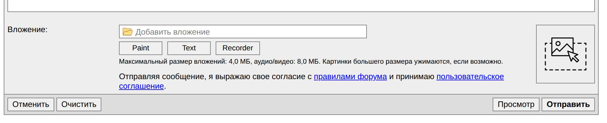
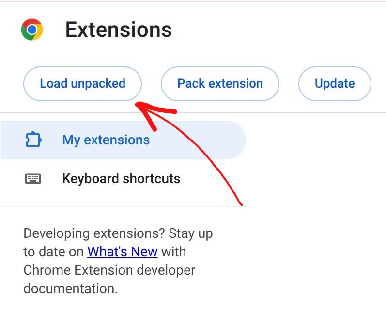
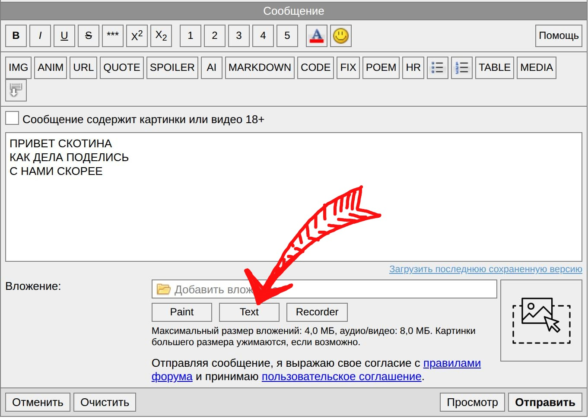
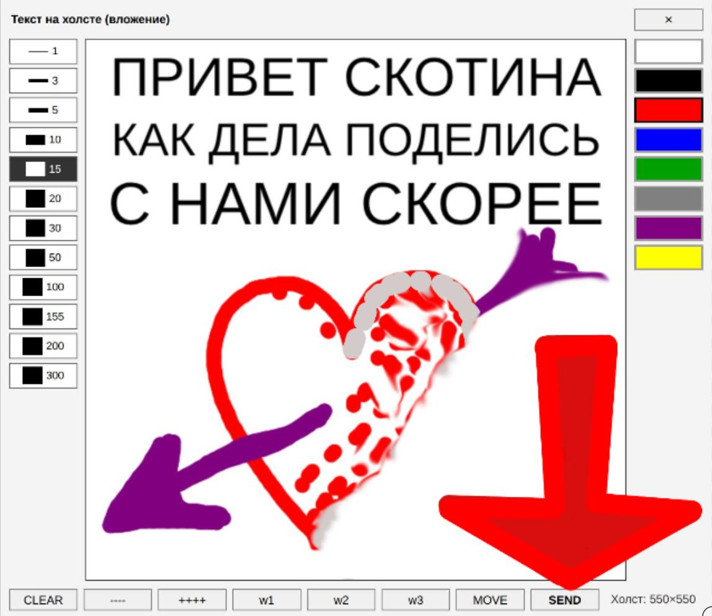

# Installation 💾

### Шаг 1
```
mkdir ~/git
cd ~/git
git clone https://github.com/pavelkolodin/dedoforum-draw.git
```

### Шаг 2
Google Chrome -> `chrome://extensions/`, справа наверху включить "Developer Mode".

### Шаг 3
"Load unpacked" ("загрузить распакованное...") -> выбрать каталог `~/git/dedoforum-draw/` из Шага 1 в появившемся окне.



### Шаг 4

Нажать F5 на форуме. 

# Как пользоваться 🧔

### Сочинить текст

Сочиняем небольшой текст и нажать кнопку **Text**. Эта кнопка переведёт текст в красивую картинку и покажет в новом окне графического редактора.



### Поревьюить макет и приаттачить его

Появится графический редактор с картинкой, которую можно дорисовать. Когда картинка устраивает,  нажать **ATTACH**. Картинка приаттачится в форму и можно отправлять сообщение.



# Досвидания

Пока-пока кисоньки.
